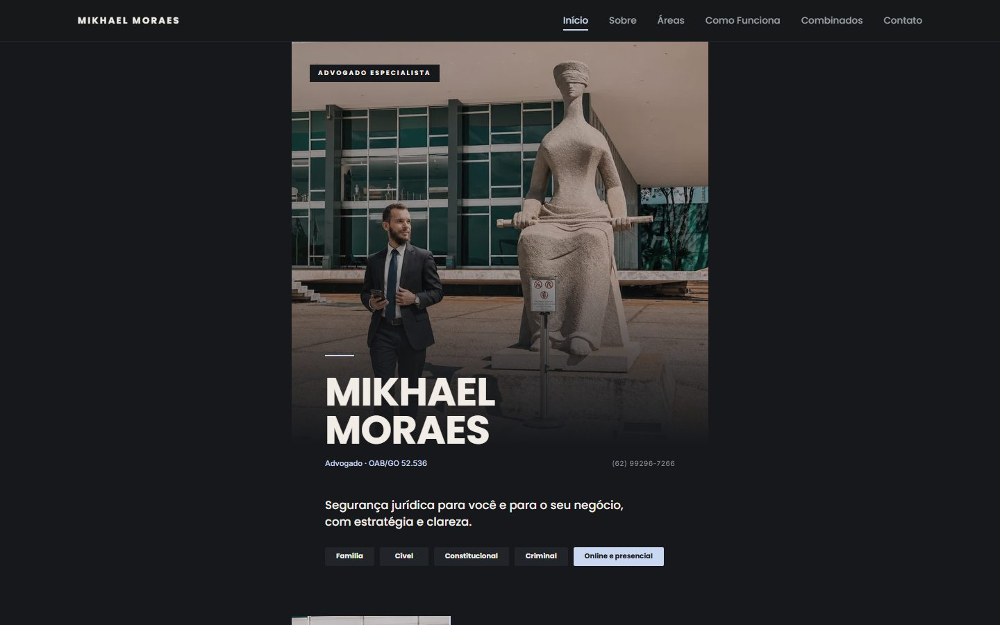
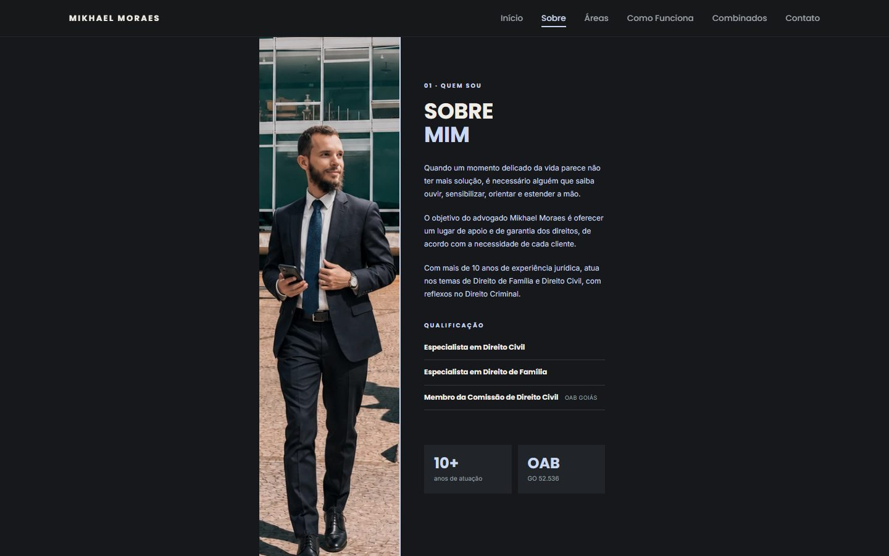
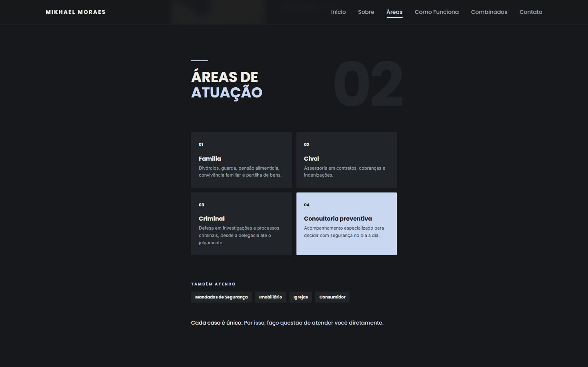
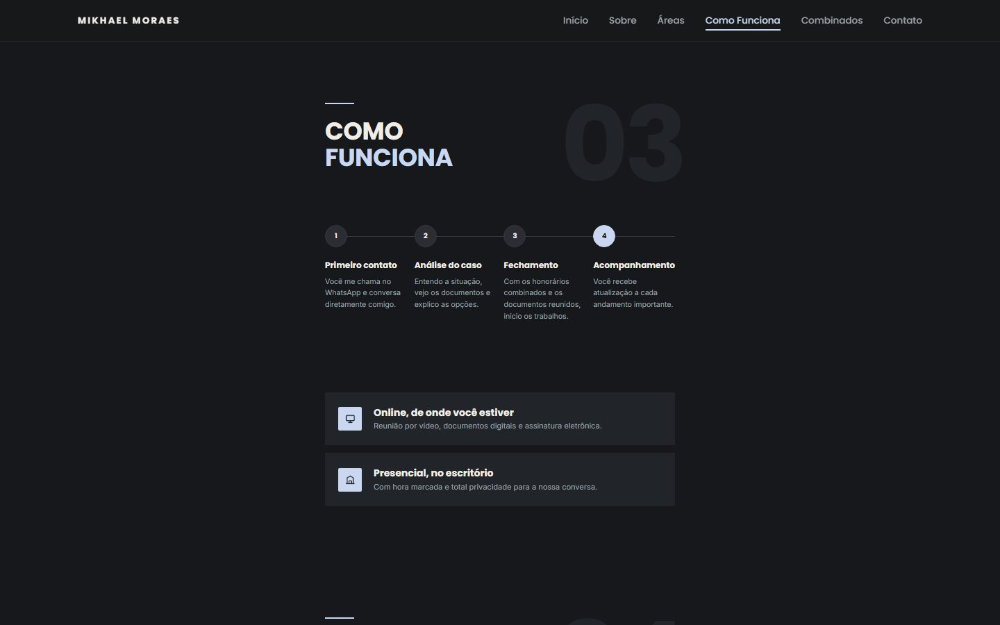
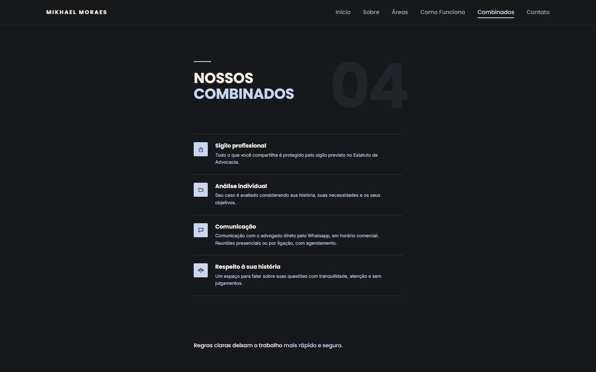
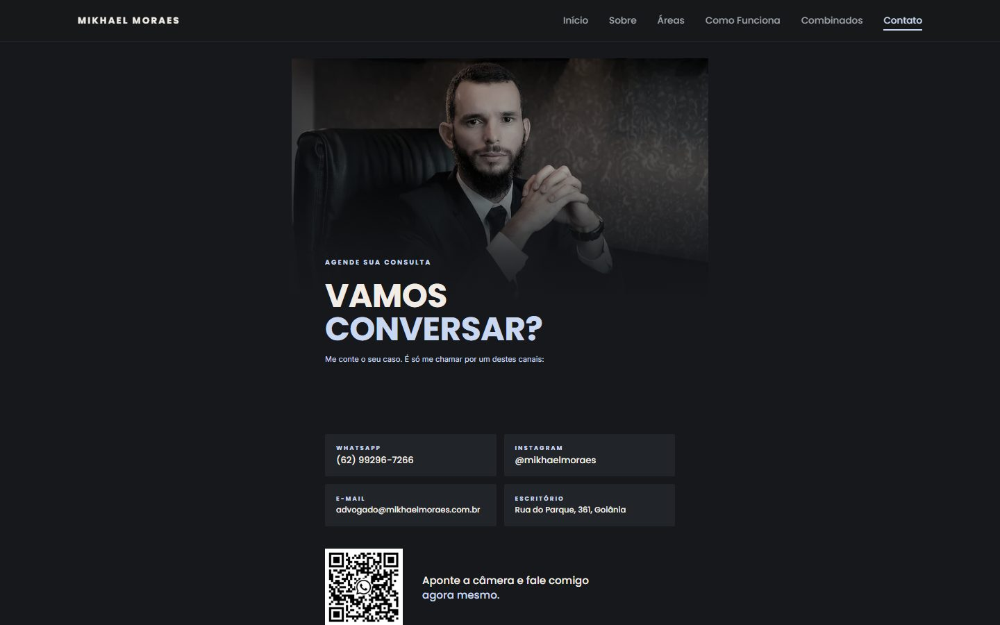
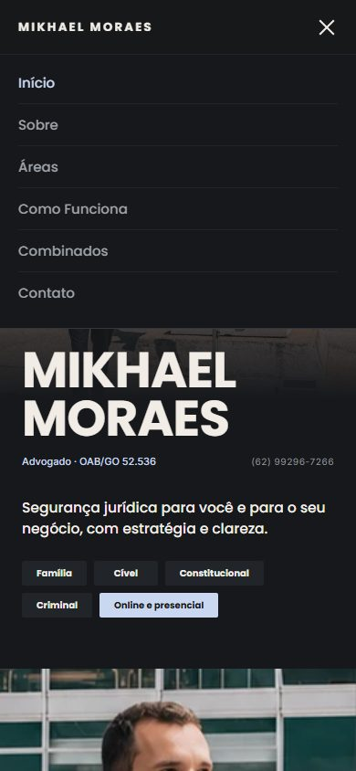
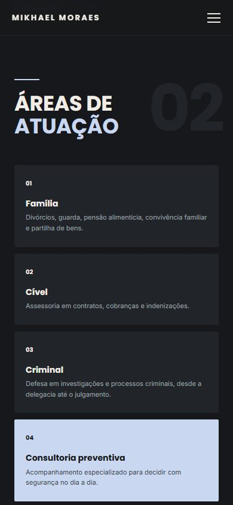

# Mikhael Moraes · Advogado — Landing Page

Landing page de página única (one-page) recriada a partir do site original no Canva, que tinha 6 páginas separadas. A identidade visual foi mantida: mesmas cores, fontes, imagens e textos, agora em uma página contínua com menu fixo.

**Stack:** HTML5 + CSS3 + JavaScript puro (sem frameworks, sem build).



## Resultado

### Desktop (1440px)

| Sobre | Áreas de atuação |
|---|---|
|  |  |
| **Como funciona** | **Nossos combinados** |
|  |  |



### Celular (390px)

| Início | Menu aberto | Áreas | Contato |
|---|---|---|---|
|  |  |  |  |

## Recursos

- 6 seções: `#inicio`, `#sobre`, `#areas`, `#como-funciona`, `#combinados`, `#contato`
- Menu fixo com rolagem suave e destaque da seção visível (IntersectionObserver)
- Menu hambúrguer no celular e botão "voltar ao topo"
- Links diretos para WhatsApp, Instagram, e-mail e Google Maps
- Imagens WebP em vários tamanhos (`srcset`), `loading="lazy"` e `width`/`height` definidos
- HTML semântico, foco visível e contraste adequado
- SEO básico: title, meta description, Open Graph e favicon

**Lighthouse:**

| | Performance | Acessibilidade | Boas práticas | SEO |
|---|---|---|---|---|
| Celular | 95 | 100 | 100 | 100 |
| Desktop | 100 | 100 | 100 | 100 |

## Estrutura

```
index.html          # página única com as 6 seções
css/style.css       # estilos (variáveis de cor e fonte em :root)
js/main.js          # menu hambúrguer, seção ativa no menu, voltar ao topo
assets/             # imagens WebP, ícones, favicon e imagem Open Graph
docs/screenshots/   # prints usados neste README (não fazem parte do site)
```

## Rodar localmente

Abra o `index.html` no navegador ou use um servidor estático:

```bash
npx http-server . -p 8080
```

## Publicar

- **Netlify:** arraste a pasta do projeto em https://app.netlify.com/drop
- **Vercel:** `npx vercel` e depois `npx vercel --prod`

Também é possível importar este repositório direto na Vercel ou na Netlify para publicar automaticamente a cada envio ao repositório.

Após publicar, troque o caminho de `og:image` no `index.html` pela URL completa do domínio.
